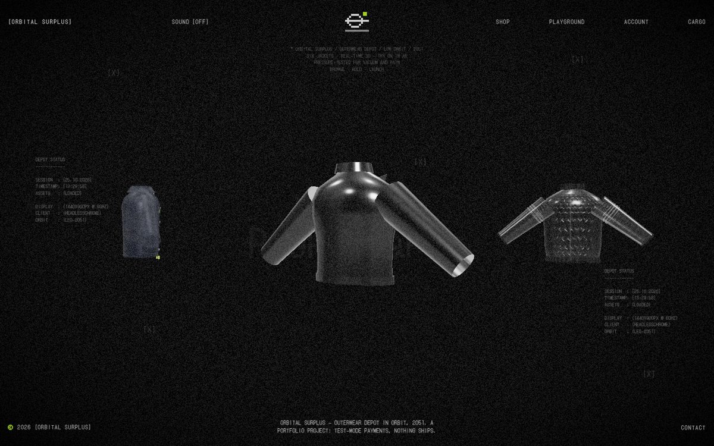
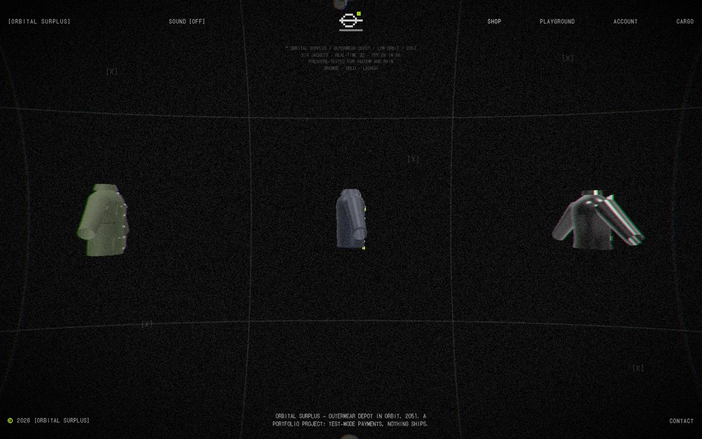
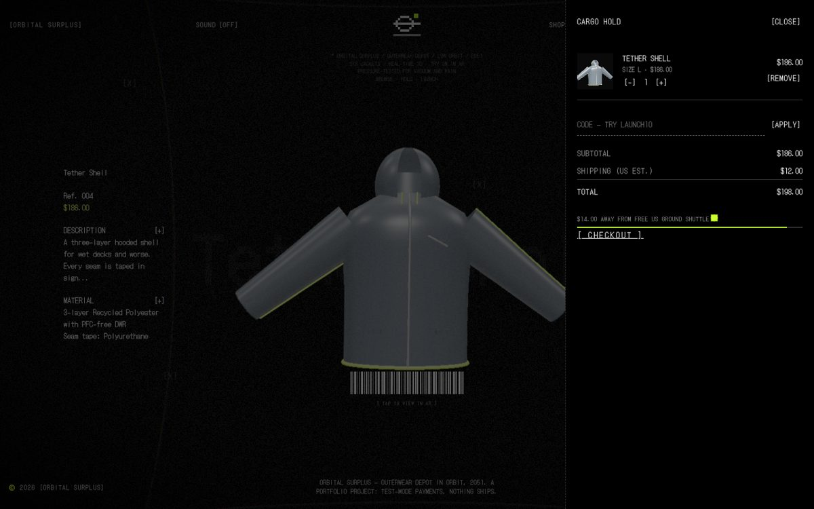
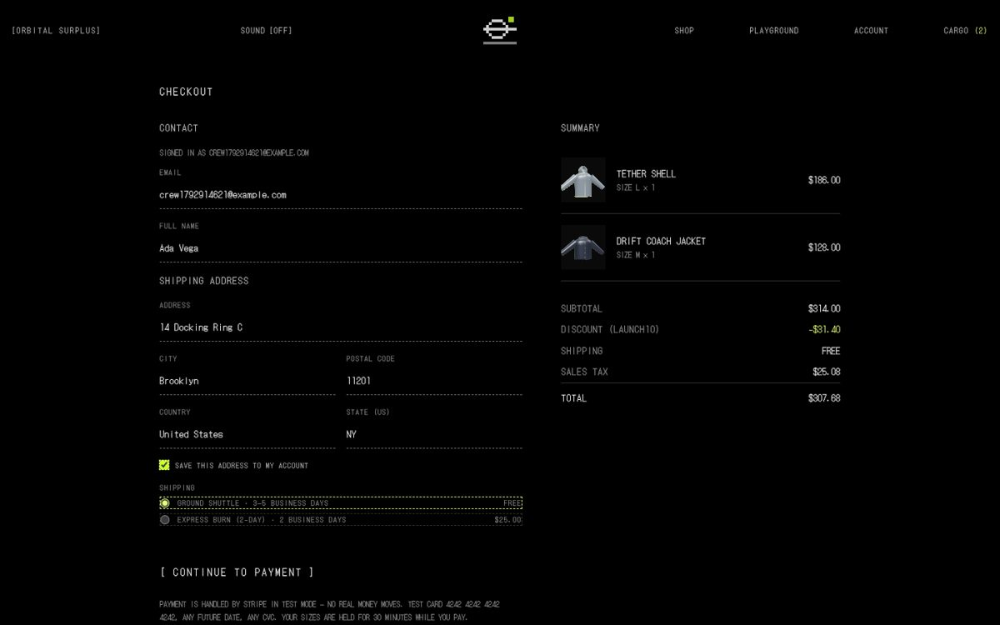
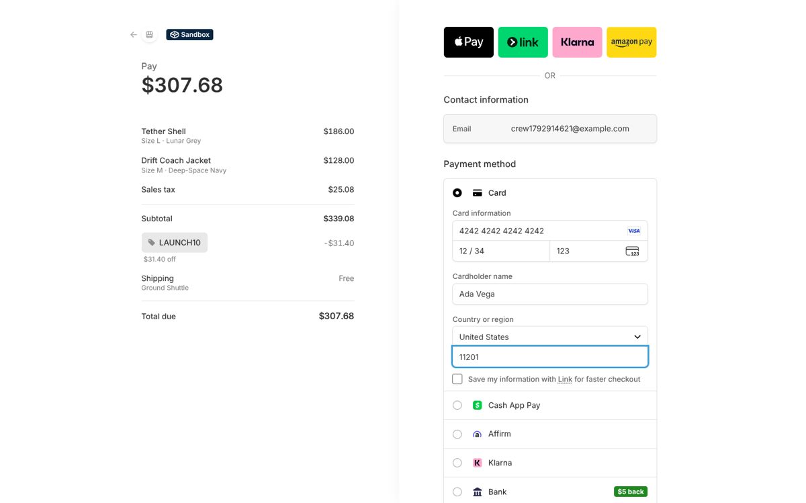
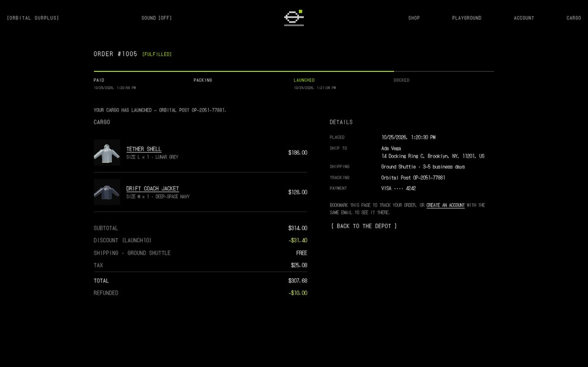
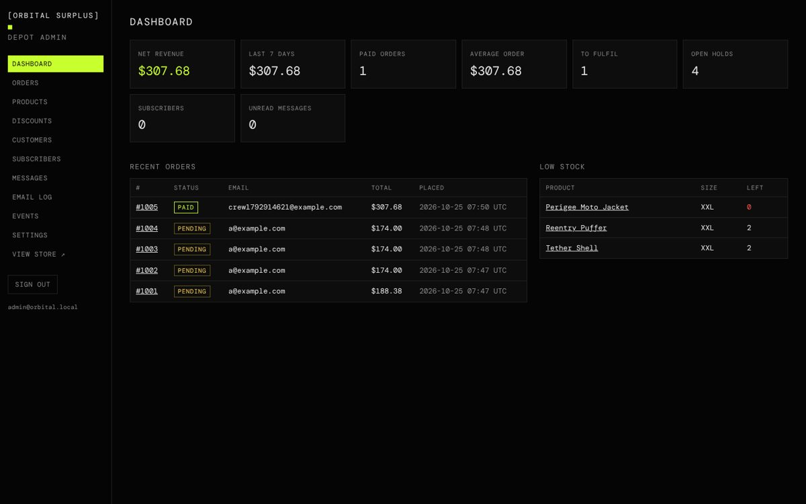

# ORBITAL SURPLUS

**Outerwear depot in orbit, 2051.** A full-stack WebGL store: six jackets you can spin in real-time 3D and try on in AR. Behind it are a Postgres catalogue with per-size stock, carts, discount codes, Stripe Checkout, customer accounts and a depot admin.

**Live:** https://orbital-surplus.vercel.app

> This is a portfolio project. Payments run in Stripe **test mode**, so no money moves and nothing ships. Use card `4242 4242 4242 4242` with any future date and any CVC.



| | |
|---|---|
|  |  |
|  |  |
|  |  |

## What it does

**Storefront** (vanilla ES modules, three.js r182, GSAP)
- A preloader decode, a dither page curtain, a turntable home carousel and an infinite lens-distorted 3D shop grid. Click a jacket and the camera dollies into the product HUD.
- Six **procedural jackets** built from lathe, tube and extrude geometry: moto, hex-embossed bomber, quilted puffer, hooded shell with taped seams, four-pocket field jacket and coach jacket. Each has its own PBR finish. The product photos (and the images Stripe shows) are PNG renders of the same models.
- AR viewer: WebXR / Quick Look from a GLB exported in the browser, with a QR handoff on desktop.
- **Cargo hold** (the cart drawer) shows a free-shipping meter, low-stock warnings and discount codes.
- **Checkout** shows a live shipping and sales-tax quote and redirects to **Stripe Checkout**. Signed-in shoppers get their saved address filled in.
- **Order tracking** page (paid → packing → launched).
- **Accounts:** sign up, sign in, reset password, order history and saved address. Guest orders attach to an account registered with the same email.
- Per-route SEO rendered on the server: title, meta, Open Graph, JSON-LD Product and Breadcrumb data, a sitemap, `robots.txt`, `llms.txt`, and real 404s.

**Backend** (Node 20, no framework, one Vercel Function)
- **Postgres** (Neon) via `postgres.js`. Local development and tests use **PGlite**, so there's nothing to install.
- **Stock is held at checkout.** One transaction takes the units with `UPDATE … WHERE stock >= qty` and inserts a `pending` order that expires after 31 minutes. If two shoppers race for the last jacket, only one hold succeeds.
- **Stripe Checkout** is called through the REST API. Discounts become one-off coupons, and shipping goes in as `shipping_options`.
- An order is marked paid by whichever arrives first: the return page (which checks the session with Stripe) or the **signed webhook** (HMAC with timestamp tolerance, deduplicated by event id). Marking paid is idempotent. Expired, cancelled or abandoned checkouts put their stock back.
- **Accounts:** scrypt password hashes. Session tokens are stored only as SHA-256. Logins are throttled to 8 attempts per 15 minutes per email and IP. A visitor's cart merges into their account cart when they sign in.
- **Depot admin** at `/admin` (server-rendered and session-protected):
  - dashboard with revenue, open holds and low stock;
  - orders: search, fulfil with tracking, partial refunds through Stripe, cancel;
  - products: price, compare-at price, draft/active, stock per size, copy, plus new products;
  - discount codes;
  - customers, subscribers (CSV export) and contact messages;
  - an email log with previews;
  - a webhook and event log;
  - a one-click Stripe webhook connect.
- **Email:** order confirmation, shipping, refund, welcome and password reset. Every message is logged to the database and is also sent through Resend when `RESEND_API_KEY` is set.
- **Security:**
  - a nonce-based CSP and the usual security headers;
  - Origin checks on every mutating request (API and admin forms);
  - body size limits and input validation;
  - prices always computed on the server;
  - no raw stock counts exposed.

## Run it locally

```bash
npm install
npm run dev          # http://localhost:3000 (PGlite in .data/, built-in test card instead of Stripe)
npm test             # 9 end-to-end API tests against in-memory Postgres
```

Admin: http://localhost:3000/admin (`admin@orbital.local` / `orbital-admin` locally; set `ADMIN_EMAIL` and `ADMIN_PASSWORD` in production).

Discount codes: `LAUNCH10` (10% off), `ORBIT20` (20% off orders of $250 or more), `DOCKED15` ($15 off orders of $100 or more).

## Environment

| Variable | Purpose |
|---|---|
| `DATABASE_URL` | Neon pooled connection string. Without it, PGlite is used. |
| `STRIPE_SECRET_KEY` | `sk_test_…`. Without it, a built-in test-card page stands in for Stripe. |
| `STRIPE_WEBHOOK_SECRET` | Optional. Otherwise use **Admin → Settings → Connect webhook**, which registers `/api/webhooks/stripe` and stores the signing secret. |
| `ADMIN_EMAIL`, `ADMIN_PASSWORD` | The depot admin account, created or updated on boot. |
| `RESEND_API_KEY`, `EMAIL_FROM` | Optional. Sends the transactional emails for real. |

## Layout

```
api/index.js        Vercel Function entry → server/server.js
server/
  server.js         router, cookies, static files, SPA shell
  store.js          catalog cache, stock, carts, discounts, shipping, tax
  checkout.js       holds, Stripe sessions, markPaid / release, webhook
  stripe.js         Stripe REST client + signature verification
  auth.js           customers, sessions, throttling, password reset
  admin.js          /admin pages and actions
  email.js          transactional email (Resend or log)
  seo.js            per-route meta + JSON-LD, sitemap, robots, llms.txt
  security.js       CSP, headers, rate limit, validators
  db.js, schema.sql Postgres (Neon) / PGlite
  shell.html        SPA shell (served only through seo.js)
public/             static frontend (served by the CDN)
  js/three/jacket.js  the six procedural jackets
data/products.json  seed catalog
test/api.test.mjs   backend tests
```

The motion system and page structure started from a study skeleton of an immersive WebGL marketplace. The brand, copy, jackets and backend are original to this project.
